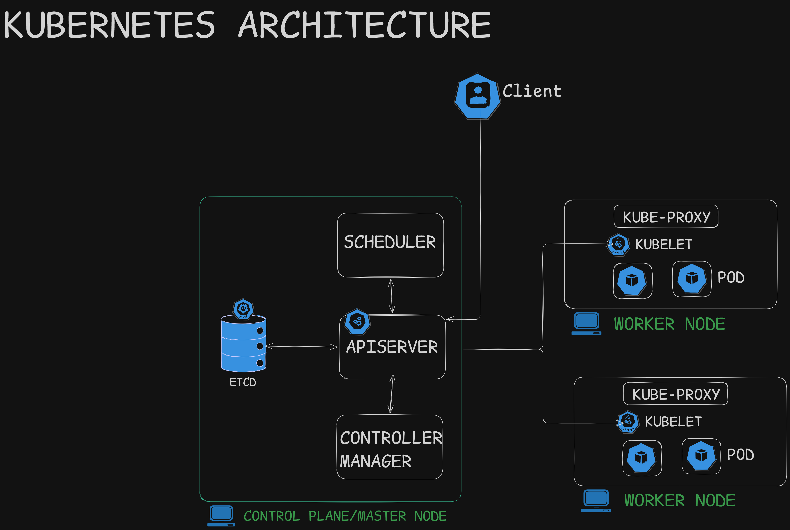
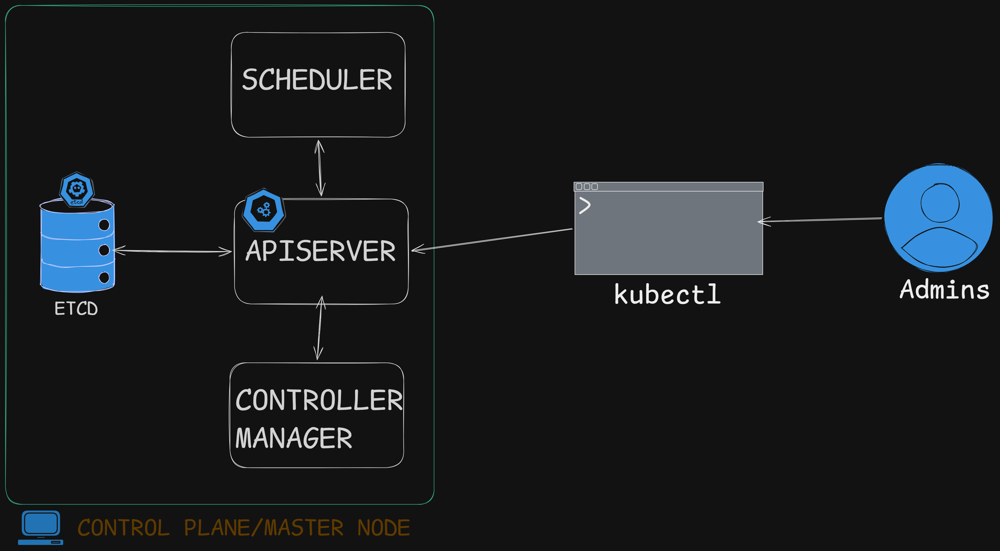

## 1. Kubernetes Architecture Overview

Kubernetes follows a **Client-Server**  architecture. Instead of running applications on a single machine, Kubernetes distributes the workload across a cluster of machines. The cluster is logically divided into two main parts: the **Control Plane** (which makes the global decisions) and the **Worker Nodes** (which do the actual heavy lifting).

### The Control Plane (Master Node) Components
The Control Plane is the brain of the cluster. It doesn't run our end-user applications; instead, it manages the workers and ensures the entire system runs smoothly.

*   **API Server:** The central gateway of the cluster. Every command from a user (Client/Admin) or internal communication between components goes through the API Server. It authenticates requests, validates them, and acts as the cluster's front desk.
*   **etcd:** A highly available, consistent key-value database. It acts as the ultimate single source of truth for the cluster, storing the entire configuration and the desired state of our system. If the cluster crashes, `etcd` is what helps it remember exactly how things were.
*   **Scheduler:** The "matchmaker" or decision-maker. When we request a new Pod to be created, the Scheduler evaluates the resource requirements (like CPU and RAM) and decides which Worker Node is best suited to host it.
*   **Controller Manager:** The cluster's supervisor. It continuously monitors the current state of the cluster and compares it to the desired state stored in `etcd`. If a Node crashes and a Pod dies, the Controller Manager detects the mismatch and triggers the creation of a replacement to maintain high availability.

## 2. Worker Nodes, Pods & Containers
Worker Nodes are the physical or virtual machines where our applications actually run.

*   **Kubelet:** The primary node-level agent running on every Worker Node. It listens to instructions from the API Server and ensures that the assigned containers are running, healthy, and behaving as expected inside their Pods.
*   **Kube-Proxy:** The network traffic controller. It maintains network rules on the Node, allowing seamless communication between Pods and routing external traffic from users directly to the correct application.

### Understanding Pods vs. Containers
*   **Container:** The isolated package of our application code, dependencies, and runtime (like a Docker container running Nginx or a backend API).
*   **Pod:** The smallest deployable computing unit in Kubernetes. Kubernetes does not run containers directly; instead, it wraps one or more related containers inside a **Pod**. A Pod provides a shared network (local IP address) and storage space for the containers inside it, acting as a logical "wrapper" or "capsule".

## 3. End-to-End Flow: Running a Kubectl Command

What exactly happens when an Admin types a command in the terminal to deploy an application? Here is the step-by-step flow:

1.  **The Request:** The Admin uses the `kubectl` CLI tool to send a command (e.g., "Create 3 Nginx Pods").
2.  **API Server Validation:** The request hits the API Server, which checks if the user has the right permissions and validates the command.
3.  **State Update:** The API Server updates the `etcd` datastore with the new desired state ("We now need 3 Nginx Pods running").
4.  **Scheduling:** The Controller Manager notices the missing Pods. The Scheduler then kicks in, evaluates all available Worker Nodes, and assigns the new Pods to specific Nodes based on their available capacity (CPU/Memory).
5.  **Execution:** The API Server contacts the `Kubelet` on the selected Worker Nodes. The Kubelet instructs the node's container runtime to pull the image and spin up the containers inside the new Pods. Once running, it reports the "Ready" status back to the API Server.