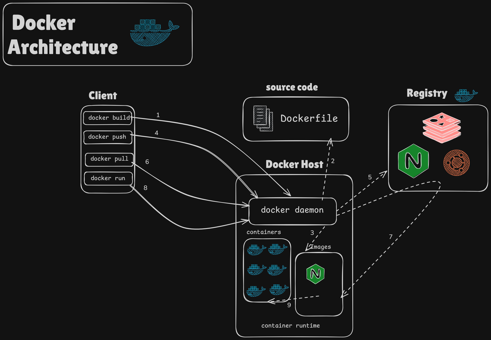
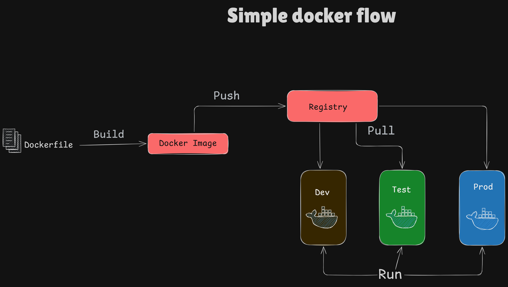

# Day 1: Docker Architecture & Workflow

## 1. Docker Architecture

* **Docker Client:** Είναι το εργαλείο από όπου δίνουμε τις εντολές στο Docker.
* **Docker Daemon:** Είναι ο "εγκέφαλος" που τρέχει στο παρασκήνιο, ακούει τις εντολές και διαχειρίζεται τα containers.
* **Docker Registry:** Το ψηφιακό αποθετήριο στο ίντερνετ όπως το Docker Hub όπου αποθηκεύονται και μοιράζονται τα έτοιμα images.

## 2. Simple Docker Flow

* **Build:** Μετατρέπει τον κώδικά μας (Dockerfile) σε ένα έτοιμο πακέτο (Docker Image).
* **Push:** Ανεβάζει το Image μας στο Registry.
* **Pull:** Κατεβάζει το Image από το Registry σε όποιο περιβάλλον το χρειαζόμαστε.
* **Run:** Παίρνει το Image και το εκτελεί, δημιουργώντας ένα ζωντανό Container.